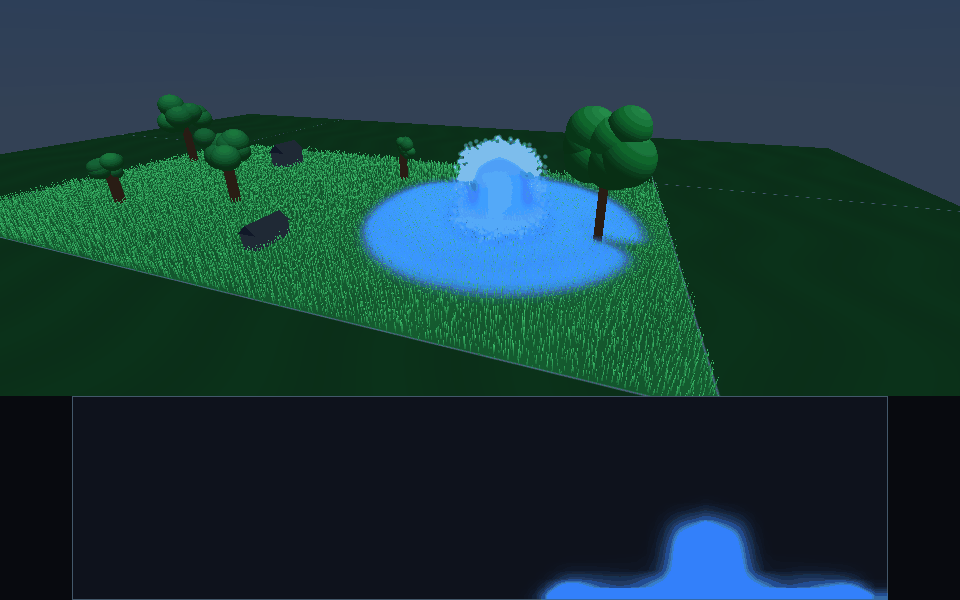
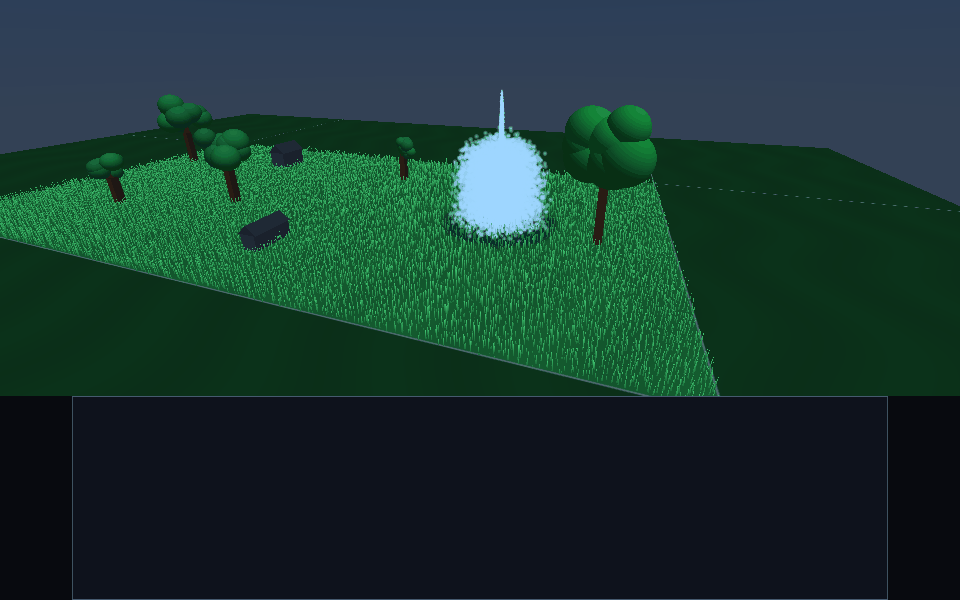
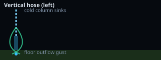
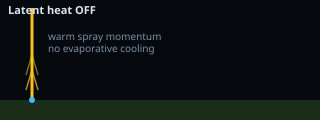
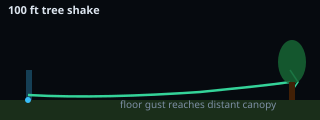
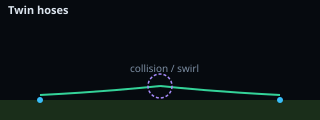
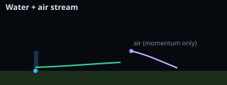
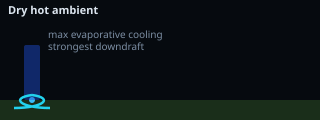

# wind_manager

An interactive simulation of **evaporative downdraft** — the real effect behind the garden-hose observation: a fine water spray evaporatively cools the air it rises through, that cooled air becomes negatively buoyant and sinks, and the sinking column spreads along the floor as a radial outflow gust (a backyard dry microburst).

The main app is a **WebGPU** coupled air / droplet / temperature solver. Drag emitters on the canvas, tune ambient humidity, toggle latent heat, and watch grass, trees, and flow tracers respond.

## Getting started

### Requirements

| Requirement | Details |
|---|---|
| **Browser** | Chrome 113+, Edge 113+, or another Chromium browser with **WebGPU** enabled |
| **GPU** | Any GPU with a working WebGPU adapter (most discrete and integrated GPUs from the last ~8 years) |
| **Node.js** | 18+ (for development only — the built app is static) |

**WebGPU check:** open the app. If you see *"WebGPU unavailable"*, try:

1. Update Chrome or Edge to the latest version.
2. Visit `chrome://gpu` and confirm **WebGPU** is *Hardware accelerated*.
3. On Linux, ensure Vulkan drivers are installed for your GPU.
4. Firefox WebGPU support is improving but Chrome/Edge are the most reliable today.

Safari 18+ has WebGPU on macOS; test before relying on it in production demos.

### Run locally

```bash
npm install
npm run dev
# open the URL shown (usually http://localhost:5173)
```

| Command | Purpose |
|---|---|
| `npm run dev` | Hot-reload development server |
| `npm run build` | Production build → `dist/` |
| `npm run preview` | Serve the production build locally |
| `npm run lint` | ESLint on `src/**/*.ts` (TypeScript-aware rules) |
| `npm run verify` | Lint + `tsc --noEmit` + production build (pre-push / CI) |
| `npm run check:wgsl` | Validate every concatenated shader module with Naga (needs `naga`, see below) |
| `npm run check:ref` | Build and run the C++ scalar reference; check it still matches the shaders (needs `cmake` + a C++17 compiler) |
| `npm run check:volume-pressure` | CPU checks of the yard volume's pressure operator, multigrid levels and V-cycle convergence |
| `npm run check:volume` | Headless acceptance run of the yard volume in Chromium + WebGPU (needs Playwright; see [Yard volume](#yard-volume-volumehtml)) |

### Verification

Before opening a PR or pushing to `main`, run:

```bash
npm run verify
```

This runs ESLint (`eslint.config.js`), TypeScript strict checking (`tsconfig.json` with `"strict": true`), and the Vite production build.

`verify` never executes a shader or checks a physics constant, so CI also runs two checks that need no GPU. The GitHub Actions workflow (`.github/workflows/ci.yml`) runs `verify`, `check:volume-pressure` and `check:wgsl` in its `verify` job and `check:ref` in its `ref` job, on push and pull requests. Run all three before opening a PR that touches `src/shaders/`, `src/sim/params.ts`, or `ref/`.

#### Shader validation (`npm run check:wgsl`)

`createSim`, the tracer module and the renderer never compile a `.wgsl` file on its own: each one joins `[generated MAX_EMITTERS prelude] + common.wgsl + <shader>.wgsl` (the yard volume's `vol_*.wgsl` modules also add `vol_common.wgsl`, see `src/volume/shaderParts.ts`). `scripts/validate-wgsl.mjs` rebuilds exactly that text for all fourteen modules and runs [Naga](https://github.com/gfx-rs/wgpu/tree/trunk/naga) on each, mapping errors back to `file:line`. It also fails if a `.wgsl` file is missing from its module table, if the TypeScript that builds a module disagrees with the table, or if a pipeline's `entryPoint` name no longer exists in WGSL.

```bash
cargo install naga-cli --version 30.0.2 --locked   # once; or set NAGA=/path/to/naga
npm run check:wgsl
```

Naga is not Tint (Chrome's compiler), so a pass means "Naga accepts it", which also covers Firefox's WebGPU. Runtime `getCompilationInfo()` in `compileShaderModule` remains the check for the browser you actually run. One convention follows from this: **do not pass `ptr<storage, …>` or `ptr<uniform, …>` to functions.** That needs the WGSL `unrestricted_pointer_parameters` extension, which Naga has not implemented. Read the module-scope binding directly instead (see `sample_vel` in `tracers.wgsl` and `render.wgsl`).

#### C++ scalar reference (`npm run check:ref`)

The solver stays in WGSL on the GPU. `ref/` is not a second simulator: it restates only the closed-form scalars documented below (`q_sat`, virtual temperature, one d² radius step and the mass it implies, and the latent `ΔT`), in one translation unit, and pins them to golden values for dry 30 °C air (20 % RH) and a 100 µm drop, with latent heat on and off. The golden values were derived independently at 50-digit precision, and the relative tolerance is `1e-9`: tight enough to catch a transposed digit in a constant, loose enough to ignore compiler differences.

`scripts/check-ref-parity.mjs` stops `ref/` from drifting away from the code it mirrors: the constants in `ref/wind_ref.hpp` must equal those in `common.wgsl`, and the pinned formulas must still appear verbatim in `common.wgsl`, `droplets.wgsl`, `params.ts` and this README. If it fires after an intentional change, update `ref/`, re-derive the golden values in `ref/wind_ref_test.cpp`, then update the pin.

**Lint policy:** `no-explicit-any` is an error. Prefer typed helpers in `src/ui/dom.ts` and `src/render/webgpu.ts`. If you must suppress a rule, use `// eslint-disable-next-line <rule> -- <reason>` on the next line only — not blanket file disables.

### First 60 seconds

1. **Load a preset** — try *100 ft tree shake* or *Strong vertical hose (left)*.
2. **Watch the temperature overlay** (default) — blue = cooled air sinking; warm colors rise with the spray.
3. **Toggle latent heat OFF** — same spray geometry, but momentum-only updraft instead of downdraft (proof of mechanism).
4. **Click the canvas** to place water emitters; **Shift+click** for pure air streams (momentum only).
5. **Load *Spray into the left house*** — the wall gets wet and the gust sheds along it; toggle **Obstacles** OFF to see the old see-through houses.
6. **Copy link** (Share panel) to bookmark or share an exact experiment.

---

## The physics (plain language)

Think of three coupled things happening at once:

### 1. Tiny water drops cool the air (latent heat)

When a droplet evaporates, it steals heat from the surrounding air — the same reason sweating cools you. In the sim, each droplet shrinks following a **d² law**: the rate at which its *surface area* delivers vapor depends on how dry the air is. Dry, hot ambient air evaporates drops fastest.

### 2. Cooled humid air is "heavy" (virtual temperature)

Humid air contains water vapor, which is lighter than dry air — but **evaporative cooling** usually wins. The sim uses **virtual temperature**: a single number that combines actual temperature and humidity to decide whether a parcel floats or sinks. After a spray passes through, the local virtual temperature drops → the parcel becomes **negatively buoyant** → it sinks.

Toggle **latent heat OFF** to disable evaporative cooling. The spray still pushes air upward (momentum), but no cooling → no downdraft. This is the "proof" that evaporation drives the effect.

### 3. Sinking air spreads along the floor

The cold column hits the ground and fans outward as a **density current** — the gust that rattles distant leaves. Houses and tree trunks are solid: the current rides over and around them rather than through. Flow tracers (cyan streaks) ride this outflow. Grass bends with local velocity; the hero tree on the right sways when the gust arrives.

**Air stream emitters** inject momentum only — no water, no humidity, no latent heat. Use them to steer or reinforce outflow without adding evaporation.

---

## Physics notes

Technical reference for the implemented model. This is a visualization-oriented stable-fluids solver, not a research CFD code — but the mechanisms are physically motivated.

### Governing idea

Coupled **Eulerian** fields (velocity **u**, temperature **T**, humidity **q**) on a collocated grid, plus **Lagrangian** droplets that exchange mass, heat, and momentum with the grid.

Each timestep (simplified):

1. Emit droplets / air impulses from configured sources.
2. Update droplets (drag, gravity, evaporation, grid deposition, floor and wall contact).
3. Apply scattered sources to **u**, **T**, **q** from droplet coupling.
4. Advect **u**, **T**, **q** into the other half of the ping-pong buffers.
5. Buoyancy from virtual temperature → update the advected **u**.
6. Boundary conditions (no-through floor, open sides and top, solid walls).
7. Pressure projection (three-level multigrid V-cycle); the advected half becomes current. No boundary velocity edits run after projection.

The advanced **Pressure V-cycles** control replaces the old Jacobi iteration count (default: 2 cycles, range: 1–4). Each cycle uses two weighted-Jacobi pre/post smooths per level and twelve coarsest-level smooths. Levels halve both even dimensions, stopping before either would become odd. The shared 64-byte simulation uniform is unchanged; old saved links use the default cycle count.

Velocities remain cell-centred. The pressure matrix is the actual collocated gradient's `GᵀG` operator, not a five-point approximation to its stride-two stencil. Restriction sums residuals within connected, same-parity fluid aggregates; prolongation injects their corrections, and coarse operators use `PᵀAP`. This preserves the centred stencil's parity subgrids and never joins fluid across a solid wall. Top ghost pressure is zero, side pressure is Neumann, and floor/wall-normal velocity components are constrained to zero.

The status panel reports **Max |div u|** in s⁻¹ from the final velocity field using the same discrete divergence as projection, not the pre-solve RHS. `npm run check:pressure` checks operator/transfer consistency, wall constraints, even grids, diagnostics, and residual reduction against the previous 30-iteration five-point solve. For a hardware comparison, load **100 ft tree shake**, keep the grid/substeps and simulation time identical, and compare this value and FPS against the old revision; software rendering is not a 60-fps hardware benchmark.

### Solid obstacles

Houses and tree trunks from the shared backyard layout (`src/render/sceneData.ts`) are **solid**. On every reset (and when the domain, grid or the **Obstacles** toggle changes) `src/sim/solids.ts` rasterizes them into one per-cell mask (`Fields.solid`): each house is a box plus its stepped roof triangle, each trunk a narrow column up to half the tree height. Foliage stays porous (not modeled). The stylized scene draws houses and trunks from the same snapped boxes, so a house that blocks the wind sits on exactly the cells that block it; the field overlays hatch solid cells.

- **Walls**: velocity inside a solid is zero, and a fluid cell next to a solid face has zero wall-normal velocity. The floor (`j = 0`) stays a no-through floor.
- **Pressure**: solid cells are not pressure unknowns. Gradient rows normal to solid faces are disabled, and every multigrid level respects that connectivity. Velocity inside a solid stays zero.
- **Advection**: velocity back-traces see the walls' zero velocity; **T** and **q** only blend fluid cells, so nothing is pulled out of a house.
- **Spray**: a drop that enters a solid leaves its water the way floor contact does (vapor, a little latent cooling, splash momentum along the surface) on the fluid side, wets the face it struck (shown as a darkened wall), runs a share down to the ground at the wall's foot, and dies. Droplet and air-stream deposits only land in fluid cells, and an air stream stops at the first wall in its path.
- **Tracers** are not seeded inside solids and slide along walls instead of stepping into them.

### d² evaporation law

For each droplet, radius squared changes at a rate proportional to the local humidity deficit:

```
dr²/dt ∝ −(q_sat(T) − q_local)
```

Mass evaporated `dm` is computed from `r` and `r_new`. This is the classic **d² law** for droplet evaporation, augmented with a Sherwood-number style correction for relative motion.

### Latent heat coupling

When latent heat is ON, evaporation deposits a temperature decrement to grid cells:

```
ΔT = −L_v · dm / (m_cell · c_p)
```

where `L_v ≈ 2.45 MJ/kg`. Humidity increases by `Δq = dm / m_cell`. Ground impacts can evaporate remaining liquid with reduced latent coupling.

### Virtual temperature buoyancy

```
T_v = (T + 273.15) · (1 + 0.61 · q)
```

Vertical acceleration: `du_y/dt ∝ g · (T_v − T_v,amb) / T_v,amb`. Damping and relaxation toward ambient **T** and **q** keep the domain from drifting.

### Droplet drag

Semi-implicit Stokes drag with Reynolds correction. Droplets feel gravity and interpolate fluid velocity from the grid. Reaction momentum is deposited back to the grid.

### Numerics

- Stable-fluids style advection + collocated multigrid pressure projection
- Substeps per frame for stiff droplet coupling
- Fixed-point atomic accumulation for GPU scatter deposits
- Default grid: 512×128 over a 32 m × 8 m domain (~62 mm cells)

### What is *not* modeled

- Radiation, cloud microphysics, turbulence closures (LES/RANS)
- Droplet–droplet interaction, breakup, or size sorting
- Topography, moving obstacles, and canopy drag (houses and trunks are static solids; foliage is visual)
- Coriolis, large-scale weather forcing

---

## Yard volume (`volume.html`)

The slice above is 32 m × 8 m: its "radial" outflow is a left-right density current and the houses are a backdrop. `volume.html` is the first step toward standing in the yard: **the same solver with the extra `k` index**, a camera, and the same hose. It is a first volume, not a final renderer.

- **Solver** (`src/volume/`, `src/shaders/vol_*.wgsl`): the slice's steps in the slice's order: emit, droplet update, scatter, advect, buoyancy, boundaries, multigrid projection. All of it runs on the GPU in one command buffer per frame, with per-emitter uploads recorded in the encoder exactly as in `src/sim/step.ts`. Emitters are disks in the x–z plane spraying a cone (tilt + azimuth + half-angle), not infinite lines.
- **Solids**: houses are boxes with gable roofs, trunks are square columns, rasterized from the shared `LAYOUT` (now with `zFrac` / `dFrac`) by `src/volume/solids.ts`. The renderer draws those same boxes, so the houses in the yard are the houses in the grid.
- **Scene** (`vol_scene.wgsl`): orbit or walk at eye height (1.7 m), one canvas. Temperature is ray-marched through T (stopping at scene depth). Grass blades on the ground sheet bend with the bottom layer of velocity. The hero tree sits at the shared layout coordinate with a z, and sways from the wind loading on its trunk and crown. Nothing is copied back to the CPU per frame; a probe reads fields back about once a second for the HUD.
- **Side view**: the strip under the yard is the z slice through the hose, drawn with the slice app's temperature (or speed) ramp and hatched solids, so the latent-heat on/off comparison still has its picture.

### Grid budget and buffer sizes

The budget is about 10⁵ cells over 32 m × 8 m × 16 m (x along the yard, y up, z across). Taken literally, the suggested 256 × 48 × 8 gives 125 mm × 167 mm × **2 m** cells: eight cells for the whole 16 m depth, which cannot carry a front in +z. The default keeps the cell count and uses cubes. The literal slab is still offered, and every kernel takes per-axis spacing.

| Grid | Cells | Spacing | All buffers | Largest storage buffer |
|---|---:|---|---:|---|
| **96 × 24 × 48** (default) | 110,592 | ⅓ m cubes | 27.7 MiB | droplets 6.10 MiB |
| 128 × 32 × 64 | 262,144 | ¼ m cubes | 48.8 MiB | pressure graph 8.00 MiB |
| 256 × 48 × 8 | 98,304 | 125 × 167 × 2000 mm | 25.9 MiB | droplets 6.10 MiB |

`volumeBufferTable` (`src/volume/grid.ts`) lists the byte size of every buffer for a grid. `main.ts` checks it against the adapter's `maxStorageBufferBindingSize` and `maxBufferSize` **before** creating the device or any buffer, requests exactly the limits it uses (8 storage buffers per stage, as the slice), and re-checks it on every grid change. The panel shows the table under *GPU buffers*. Per cell: velocity 16 B (`vec4f`), T, q, solid 4 B each, scatter accumulators 8 + 12 B, pressure graph 32 B. The droplet cap stays at 200,000 (32 B each).

### Where the volume differs from the slice, and why

Each item below was found by running the volume. The slice is unchanged.

| | Slice | Volume | Why |
|---|---|---|---|
| Projection | Exact GᵀG for the centred collocated gradient | Approximate projection: compact 7-point face Laplacian, cell velocities corrected by averaged face gradients | GᵀG splits the grid into independent parity subgrids (8 in 3D), each conserving its own mass. In 3D the ground outflow in row 0 came back through rows 2, 4, 6. |
| Multigrid | 3 levels, parity-preserving aggregates, ω = ⅔, 2 + 2 sweeps | Up to 4 levels of 2 × 2 × 2 aggregates (Galerkin), ω = 6/7, 4 + 4 sweeps, 1.8× coarse correction, p warm-started across substeps | Aggregation is stable but slow on the 7-point stencil. These settings reach ~0.2 residual after one substep and < 0.01 after three on the default grid (`check:volume-pressure`). |
| Buoyancy | Cell's own T_v | T_v weighted ¼ ½ ¼ in y | With the centred gradient, p(j−1) − p(j+1) integrates the buoyancy over [y(j−1), y(j+1)]. Unweighted, the floor row's cold air never reaches the pressure. |
| Ground / wall impact | Whole drop to vapor + 12 % of its latent heat, splash `0.22 v` per drop | Impact only wets the ground (splash scaled by drop mass / cell air mass); wet ground evaporates at 5 mm/s × wetness × saturation deficit | A volume hose lands thousands of drops per second on a few cells: the slice's rule cooled the ground 24 K (below wet-bulb) and the unscaled splash fed a 40 m/s ground jet. |
| Water flow | Drops per second per metre of depth | Parcels: each computational drop carries `dropsPerParcel` real drops | A point source spreads its outflow over a circle; it needs ~220 g/s (13 L/min, a hose on full) for a gust the slice gets from a line source. Parcels give that flow inside the same 200,000-drop cap. |

### Checking it

```bash
npm run check:volume-pressure      # CPU: operator = −D_f G_f, Galerkin levels, V-cycle settings (runs in CI)
npm run check:volume -- --shots shots   # headless Chromium + WebGPU acceptance run (local)
```

`check:volume` starts a Vite server, opens `volume.html?harness` (offscreen rendering, no frame loop, `window.__wmVolume` API), runs each experiment for 20 s of sim time, and probes the GPU fields every 2 s. On a machine without a GPU it uses SwiftShader (`--use-webgpu-adapter=swiftshader`). Set `PLAYWRIGHT_MODULE=/path/to/playwright/index.mjs` if Playwright is installed globally. `--dt 0.0167` doubles the substep for a faster software run.

Last run (SwiftShader, default grid, `--dt 0.0167`, 20 s per experiment): **17 / 17 checks pass.**

| Done when | Measured |
|---|---|
| Vertical hose: outflow moves in +x and +z along the ground | Ground front (outward speed > 0.15 m/s) reaches 7.0 m in +x, 6.0 m in +z, 6.3 m in −x, 6.7 m in −z by t = 20 s; 0.4 m/s at 2 m; ground 15 K below ambient (wet-bulb) |
| …and the hero tree responds when that front arrives | Gust at the tree's base 0.21 m/s at t = 12 s (4.2 m from the hose). Outward crown sway ≤ 0.31 cm while its base is calm, 2.72 cm after the front arrives |
| Latent heat OFF does not produce that front | Same spray: no front in any direction, no cooling, and the tree is drawn 1.1 cm *toward* the hose (entrainment) instead of pushed away |
| A house footprint stops velocity in 3D as in 2D | Hose aimed at the left house: |u| = 0 in all 153 solid cells and 0 into every solid face, as the slice's mask enforces; cold air piles against the wall in the side view |
| Interactive at the budget, multigrid on, scene on | **Not verified on real hardware.** SwiftShader (CPU) takes ~0.54 s per frame, which says nothing about a GPU. The HUD shows GPU solver and scene time from timestamp queries where the adapter has them: that is the number to check. |

| Latent heat ON | Latent heat OFF |
|---|---|
|  |  |

Known limits of this first volume: the outflow is about one cell deep (⅓ m) at the tree, so it loads the trunk and lower branches, not the crown (the crown sway has a visual gain, as the slice's tree does). The ray march samples T 72 times per pixel at full resolution, the likeliest cost on integrated GPUs. Wall wetness and the slice's tracers are not ported yet.

## Configuration gallery

Schematic previews below — load the matching preset in-app for the full interactive sim. Replace these SVGs with screenshots or GIFs from your own runs via **Share → Copy link** or **Export JSON**.

| Preset | What to watch | Schematic |
|---|---|---|
| **Strong vertical hose (left)** | Tight cold column, radial floor gust, grass bend |  |
| **Latent heat OFF** | Same spray, but warm updraft — no evaporative cooling |  |
| **100 ft tree shake** | Left fence hose; outflow travels ~90+ ft to hero tree |  |
| **Spray into the left house** | Wet wall, gust shed along the wall and floor, nothing moving inside the house | — |
| **Twin hoses** | Two columns; gusts collide and swirl near center |  |
| **Water + air sources** | Evaporative downdraft plus momentum-only air steering |  |
| **Low humidity / high temp** | Hot dry air → maximum evaporative cooling |  |

**Reproducibility:** use **Share → Copy link** to encode the full state in the URL hash (`#s=…`), or **Export JSON** for offline archives.

---

## Legacy prototype vs current sim

Both apps share the same **backyard layout** (`src/render/sceneData.ts`) — tree positions, houses, clouds, and emitter fractions align across the 32 m yard. The playground imports a bundled `public/scene-shared.js` built from the same TypeScript sources as the physics sim layers.

| | **Physics sim** (`index.html`) | **Art playground** (`prototype.html`) |
|---|---|---|
| **Engine** | GPU compute shaders (WGSL), coupled fields | 2D canvas CPU particles + analytic wind |
| **Physics** | d² evaporation, latent heat, virtual-T buoyancy, pressure solve | Stylized wind blobs, no thermodynamics |
| **Scene** | **Stylized view** toggle composites painterly sky/grass/trees on the sim | Full artistic canvas (always stylized) |
| **Emitters** | Up to 8 water + air sources, precise X/Y, shareable JSON/URL | Draggable water/wind jets, pulse, quick presets |
| **Best for** | Reproducible experiments, field overlays, science demos | Fast composition, artistic exploration, teaching |

### How they complement each other

1. **Playground first** — drag emitters, tune power/angle, watch grass and trees react instantly. No GPU required.
2. **Physics sim second** — toggle **Stylized view** for the same painterly look, but driven by real velocity fields. Use temperature/humidity overlays to see *why* the trees sway.
3. **Share arrangements** — copy emitter positions from the physics sim (Share panel). Layout fractions in presets match both apps.

The playground remains at [`/prototype.html`](public/prototype.html). Shared drawing utilities live in `src/render/sceneCanvas.ts` and `src/render/sceneData.ts`; the playground loads `public/scene-shared.js` (built via `vite.scene.config.js`).

**Migration path:** concepts from the prototype (emitter placement, backyard scene, tree shake demo) were reimplemented with real field data driving the environment layer.

---

## Features

- Two-way coupled **air / droplet / temperature** solver on GPU (WebGPU)
- **Latent heat toggle** — ON → downdraft + floor outflow; OFF → momentum-only updraft
- Field overlays: velocity, temperature, humidity; droplet points; velocity arrows; flow tracers
- Multiple emitters (water spray + pure air streams), canvas drag + numeric position controls
- Backyard environment: grass, trees, houses, clouds, ground mist, wet ground
- Presets, advanced solver controls, JSON export/import, URL hash sharing
- Stable-fluids pressure projection (collocated grid + multigrid)
- Solid houses and tree trunks: the gust goes over and around them, spray wets their walls (**Obstacles** toggle)

### Module layout (`src/`)

```
src/
  main.ts       WebGPU init + frame loop
  sim/          params, fields, solids, droplets, tracers, step, simParamsUniform, presets, state
  render/       overlays, webgpu, fieldDiagnostics, grass, trees, sceneData
  ui/           controls, dom, emitters, presets, share, help
  shaders/      WGSL (?raw imports); wgsl.ts brands sources; vol_*.wgsl = yard volume
  volume/       yard volume (volume.html): grid + buffer table, params/presets, solids,
                pressure hierarchy, fields, step, scene, camera, probe, main
scripts/       CI checks: validate-wgsl.mjs (Naga), check-ref-parity.mjs, check-volume-pressure.mjs;
               volume-acceptance.mjs (headless WebGPU run)
ref/           C++ scalar reference + golden-value test (CMake)
index.html      app shell (slice); volume.html = yard volume
eslint.config.js  ESLint flat config (TypeScript + browser globals)
public/         prototype.html (legacy), gallery/ (preset schematics)
```

### TypeScript quality

The `src/` tree uses **`strict: true`** (`tsconfig.json`), ESLint with `@typescript-eslint` (`npm run lint`), and `npm run verify` (lint + `tsc` + build). CI runs the same via `.github/workflows/ci.yml`.

| Area | Module(s) | Notes |
|---|---|---|
| Sim uniforms | `sim/simParamsUniform.ts` | 84-byte `Params` layout documented; matches `common.wgsl` |
| WebGPU helpers | `render/webgpu.ts` | Pipelines, blend targets, readback buffers |
| Diagnostics | `render/fieldDiagnostics.ts` | GPU→CPU field scan for HUD stats |
| Stylized scene | `render/environment.ts`, `shaders/environment.wgsl` | Grass, trees, houses, clouds, mist, ground wetness drawn in WebGPU from the velocity buffer; no CPU readback |
| WGSL imports | `shaders/wgsl.ts` | `WgslSource` branded `?raw` strings |
| DOM | `ui/dom.ts` | Typed `$` / `$input` / `$button` helpers |

**Policy:** no `any` in `src/`; `@ts-expect-error` only when `@webgpu/types` lags the runtime API (document the reason). Remaining follow-ups: typed render/tracer uniform packers (`overlays.ts`, `tracers.ts`), migrate remaining UI files to `ui/dom.ts`.

---

## Roadmap

See open issues: https://github.com/ford442/wind_manager/issues

The garden-hose downdraft observation remains the north star — making the invisible visible and playing with the forces that move the world.
